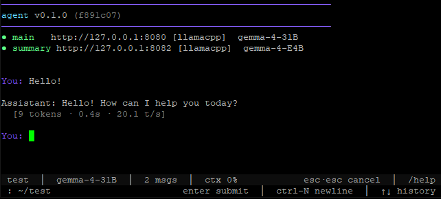

# agent

A coding assistant that runs in your terminal. You give it a task, and it reads files, edits code and runs commands until the task is done. It works with a model on your own machine (llama.cpp, Ollama, vLLM) or a hosted one.



📖 **[Documentation site](https://mblakemore.github.io/agent/)**: this README and the guides in `docs/`, rendered.

## 1. Install

On Linux or macOS with Python 3.10 or newer:

```bash
git clone https://github.com/mblakemore/agent.git && cd agent
./install.sh
```

Then open a new shell. The script sets up a virtual environment and adds an `agent` command. For Windows, manual installs and other options, see [Install](docs/install.md).

## 2. Connect a model

Run `agent` in the folder you want to work in:

```bash
cd ~/my-project
agent
```

The first time, a short setup wizard asks where your model is and connects to it:

| Your model | What to do |
| --- | --- |
| **On this machine** | Start a server first, for example `llama-server -m model.gguf --port 8080`. The wizard finds it, and three presses of Enter connect it. See [Setup](docs/setup.md). |
| **UCSB AI Commons** | Pick "UCSB AI Commons" and paste your key. See [AI Commons](docs/aicommons.md). |
| **Another hosted API** | Pick "OpenAI-compatible server", then "Another URL…". It asks for a key only if the server needs one. |

You can run the wizard again at any time with `/setup`. Not sure which model to run? See [Recommended models](docs/models.md).

## 3. Give it a task

Type what you want at the prompt:

```
You: fix the failing test in tests/test_parser.py
```

Or run a task without the interactive session:

```bash
agent -a "add a --verbose flag to cli.py"
```

A few things worth knowing on day one:

- Press **Escape twice** to stop a response.
- `/help` lists the commands. `/model` switches model, and `/setup` reconnects.
- `agent -c` continues where the last session left off.
- Settings and history live in `.agent/` in your project folder, which is kept out of git for you.

## What it does

- **Works through your project:** it reads and edits files, searches code and runs shell commands, and keeps going until the task is done.
- **Handles long sessions:** older history is summarized in the background, and progress is saved every turn.
- **Catches common model mistakes:** broken tool calls are repaired, and invented file contents are caught before they mislead it.
- **Can ask a bigger model:** an optional advisor model is consulted when the main one gets stuck.

## Learn more

| Guide | What's in it |
| --- | --- |
| [Install](docs/install.md) | Install options, Windows (Git-Bash), dependencies |
| [Setup](docs/setup.md) | Getting a local model server running |
| [Setup wizard](docs/setup-wizard.md) | Everything `/setup` does: the checklist, calibration, testing |
| [CLI and usage](docs/cli.md) | Flags, slash commands, unattended runs, environment variables |
| [Configurations](docs/configurations.md) | Common setups: one model, main + summary, adding an advisor |
| [Config reference](docs/config-reference.md) | Every `config.json` key and its default |
| [How it works](docs/how-it-works.md) | The turn loop, guardrails, escalation, code layout |
| [Agent scaffold](docs/agent-scaffold.md) | `/agent`: turning a folder into an autonomous agent repo |
| [The job contract](docs/job-contract.md) | Running the agent as a verifiable worker (`--job`) |
| [Recommended models](docs/models.md) | Which models work well and why |
| [AI Commons](docs/aicommons.md) | The UCSB AI Commons gateway |
| [Legacy Bedrock](docs/bedrock.md) | The older published-bot Bedrock gateway |
